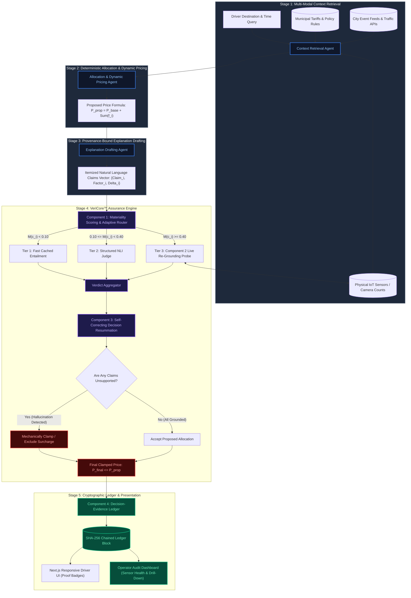
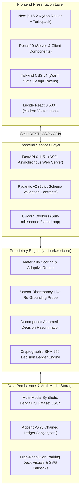
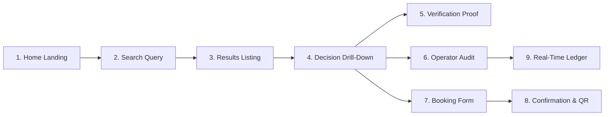

<div align="center">

# 🅿️ VeriPark (VeriCore™)

### *A Verify-Before-Explain (VBE) Agentic RAG Framework for Faithful, Context-Aware Smart Parking Allocation & Self-Correcting Dynamic Pricing*

[-000000?style=for-the-badge&logo=nextdotjs&logoColor=white)](https://nextjs.org/)
[](https://fastapi.tiangolo.com/)
[](https://python.org/)
[](https://www.typescriptlang.org/)
[](https://tailwindcss.com/)
[-ea580c?style=for-the-badge&logo=shield&logoColor=white)](#-patentable-components--intellectual-property)

<br/>

**[⚡ Executive Summary](#-executive-summary)** •
**[🎯 Problem Space](#-the-core-differentiating-problem)** •
**[🏗️ Architecture & Diagrams](#-system-architecture--engineering-design)** •
**[🔬 Patentable Components](#-patentable-components--intellectual-property)** •
**[💻 Tech Stack](#-complete-technology-stack)** •
**[📊 Validation & Results](#-preliminary-experimental-results--validation)** •
**[🚀 Quickstart](#-local-setup--developer-quickstart)**

---

</div>

## 📑 Table of Contents

- [🌟 Executive Summary](#-executive-summary)
- [⚡ The Core Differentiating Problem](#-the-core-differentiating-problem)
  - [The Trilemma of Modern Urban Parking Pricing](#the-trilemma-of-modern-urban-parking-pricing)
  - [Architectural Comparison: Traditional vs Generic RAG vs VeriPark](#architectural-comparison-traditional-vs-generic-rag-vs-veripark)
- [🏗️ System Architecture & Engineering Design](#-system-architecture--engineering-design)
  - [End-to-End Pipeline Architecture](#end-to-end-pipeline-architecture)
  - [The 5-Stage Cooperating Multi-Agent Pipeline](#the-5-stage-cooperating-multi-agent-pipeline)
  - [Sequence Flow of a Decision Transaction](#sequence-flow-of-a-decision-transaction)
- [🔬 Patentable Components & Intellectual Property](#-patentable-components--intellectual-property)
  - [Component 1: Decision-Materiality-Weighted Verification Routing](#component-1-decision-materiality-weighted-verification-routing)
  - [Component 2: Sensor-Discrepancy Live Re-Grounding](#component-2-sensor-discrepancy-live-re-grounding)
  - [Component 3: Decomposed-Factor Arithmetic Resummation](#component-3-decomposed-factor-arithmetic-resummation)
  - [Component 4: Cryptographically Chained Decision-Evidence Ledger](#component-4-cryptographically-chained-decision-evidence-ledger)
- [💻 Complete Technology Stack](#-complete-technology-stack)
- [📱 User Experience & Frontend Engineering](#-user-experience--frontend-engineering)
  - [9-Screen Unified Responsive Driver & Operator Journey](#9-screen-unified-responsive-driver--operator-journey)
  - [UI/UX Innovations & Hardened Touch Interfaces](#uiux-innovations--hardened-touch-interfaces)
- [📈 Implementation Progress & Coding Milestones](#-implementation-progress--coding-milestones)
- [🧠 Technical Competency & Innovation Analysis](#-technical-competency--innovation-analysis)
- [📊 Empirical Evaluation & Hardening Results](#-empirical-evaluation--hardening-results)
- [🛠️ Challenges Encountered & Engineering Solutions](#-challenges-encountered--engineering-solutions)
- [🗺️ Work Completed vs. Remaining Implementation Plan](#-work-completed-vs-remaining-implementation-plan)
- [🚀 Future Roadmap & Industrialization](#-future-roadmap--industrialization)
- [💻 Local Setup & Developer Quickstart](#-local-setup--developer-quickstart)
- [🔒 Confidentiality & Legal Notice](#-confidentiality--intellectual-property-notice)

---

## 🌟 Executive Summary

Modern urban transit, ride-share platforms, and smart commercial facilities increasingly rely on dynamic pricing algorithms and generative artificial intelligence. However, current systems suffer from two fatal, compounding flaws:
1. **Black-Box Pricing Opacity:** Traditional algorithms (e.g., surge pricing) treat drivers as passive consumers, forcing them to accept volatile, unexplained rates with zero accountability or municipal auditability.
2. **LLM Hallucinations & Ungrounded Rationalizations:** Standard Retrieval-Augmented Generation (RAG) pipelines generate fluent natural language explanations that frequently fabricate phantom events, misstate sensor feeds, or invent unjustified surcharges with no mathematical link to the actual transaction amount.

**VeriPark** resolves this crisis by introducing **VeriCore™**, an autonomous **Verify-Before-Explain (VBE)** assurance engine. Rather than allowing generative language models to post-hoc rationalize numbers they did not derive, VeriPark operates a multi-agent pipeline where:
- Every natural language factor claim is decomposed into an individual numerical contribution.
- The claim is scored by **decision materiality** (the exact proportion of the financial cost resting on that claim).
- Compute depth is routed adaptively based on economic consequence rather than model perplexity.
- **If any part of the explanation cannot be grounded in verifiable sensor or municipal data, the price itself is mechanically and automatically adjusted down via resummation before the user ever sees it.**
- Every decision is recorded into an append-only, SHA-256 hash-chained cryptographic ledger.

---

## ⚡ The Core Differentiating Problem

### The Trilemma of Modern Urban Parking Pricing

```
                       [ Fairness & Transparency ]
                                   /\
                                  /  \
                                 /    \
                                /      \
    (Traditional Surge Apps)   /        \   (Generic RAG Bots)
   Opaque, Discriminatory     /          \  Fluent, Hallucinatory
   Dynamic Pricing           /____________\ Post-Hoc Text
      [ Economic Efficiency ]                [ Safety & Factuality ]
                                   ▲
                                   │
                      ★ VeriPark (VeriCore™) ★
               Achieves All Three Simultaneously via
               Deterministic Mathematical Resummation
```

### Architectural Comparison: Traditional vs Generic RAG vs VeriPark

| Capability / Metric | Traditional Parking Apps (SpotHero, ParkMobile) | Generic LLM RAG (LangChain / AutoGen) | **VeriPark (Powered by VeriCore™)** |
| :--- | :--- | :--- | :--- |
| **Pricing Model** | Black-box dynamic surge | Statistical model prediction | **Decomposed Factor Formulation ($\text{Base} + \sum f_i$)** |
| **Explanation Mode** | None (opaque number) | Post-hoc text (frequently hallucinates) | **Claim-by-Claim Factor Provenance Binding** |
| **Verification Basis** | None | Model perplexity / token entropy | **Decision Materiality Sensitivity Metric** |
| **Verification Depth** | Zero | Uniform / Static LLM prompt | **Adaptive 3-Tier Compute Routing** |
| **Discrepancy Check** | None | None (trusts cached vector embeddings) | **Active Out-of-Band IoT Camera / API Probe** |
| **Failure Behavior** | User overcharged blindly | Garbage-in, garbage-out text | **Deterministic Price Resummation ($\Delta \le 0$)** |
| **Audit Mechanism** | Internal database logs | Ephemeral chat/completion logs | **SHA-256 Chained Evidence Ledger (`.jsonl`)** |
| **Safety Invariant** | Unenforced | Prompt instructions (soft barrier) | **Strict Hard Invariant: $\text{FinalPrice} \le \text{ProposedPrice}$** |

---

## 🏗️ System Architecture & Engineering Design

VeriPark is architected as a five-stage cooperating pipeline with a strict closed feedback loop.

### End-to-End Pipeline Architecture



### The 5-Stage Cooperating Multi-Agent Pipeline

1. **Stage 1: Context Retrieval Agent (`ContextRetrievalAgent`)**
   - Ingests user constraints (destination, desired parking arrival time, vehicle dimensions, duration).
   - Queries heterogeneous data sources: real-time camera occupancy streams, municipal tariff databases (peak caps, commercial zoning taxes), and city event schedules.
2. **Stage 2: Allocation & Pricing Agent (`AllocationPricingAgent`)**
   - Applies transparent mathematical rules:
     $$P_{\text{proposed}} = P_{\text{base}} + \sum_{i=1}^{k} \text{Contribution}(f_i)$$
   - Computes explicit additive surcharges (e.g., peak demand surge $+₹30$, proximity surcharge $+₹15$).
3. **Stage 3: Explanation Drafting Agent (`ExplanationDraftingAgent`)**
   - Drafts clear, driver-facing natural language justifications.
   - Strictly enforces *provenance binding* at generation time: every sentence or claim must reference an exact underlying `factor_id`.
4. **Stage 4: VeriCore™ Assurance Engine (`veripark.vericore`)**
   - Operates independently of the drafting agent.
   - Calculates decision materiality, executes the adaptive verification cascade, probes live sensors for high-consequence items, and executes self-correcting arithmetic clamping.
5. **Stage 5: Decision Ledger & Presentation (`DecisionLedger` + Next.js)**
   - Computes SHA-256 block hashes connecting the current decision to previous decisions.
   - Streams verified outcomes to the responsive mobile driver application and the operator audit portal.

### Sequence Flow of a Decision Transaction

```mermaid
sequenceDiagram
    autonumber
    actor Driver as Driver (Next.js UI)
    participant Pipeline as VeriPark Pipeline
    participant PricingAgent as Allocation & Pricing Agent
    participant ExplAgent as Explanation Drafting Agent
    participant VeriCore as VeriCore™ Engine
    participant Sensors as Live IoT Sensors / APIs
    participant Ledger as Cryptographic Ledger

    Driver->>Pipeline: Search Parking (Destination: Prestige Commercial)
    Pipeline->>PricingAgent: Propose Lot Allocation & Dynamic Price
    PricingAgent-->>Pipeline: Proposed Price: ₹85 (Base ₹40 + Demand ₹25 + Event ₹20)
    Pipeline->>ExplAgent: Draft Natural Language Justification
    ExplAgent-->>Pipeline: Claims: [C1: 85% full, C2: Tech Summit nearby]
    
    rect rgb(30, 27, 75)
        Note over Pipeline,VeriCore: VeriCore™ Assurance Engine Execution
        Pipeline->>VeriCore: Evaluate Claims & Factors
        VeriCore->>VeriCore: Calculate Materiality Scores: M(C1)=0.55, M(C2)=0.44
        VeriCore->>Sensors: Component 2 Probe: Re-check Camera & Events Live
        Sensors-->>VeriCore: Camera: 87% occupied (Confirmed). Event: Cancelled 2h ago!
        VeriCore->>VeriCore: Verdicts: C1 Supported, C2 Unsupported (Hallucination)
        VeriCore->>VeriCore: Component 3 Clamping: Remove ₹20 Event Surcharge
        VeriCore-->>Pipeline: Final Price: ₹65.00 (Adjusted down from ₹85.00)
    end

    Pipeline->>Ledger: Seal Transaction Block (SHA-256 Chaining)
    Ledger-->>Pipeline: Block Hash: 7b3f...e4a1 Sealed
    Pipeline-->>Driver: Render Results with "Adjusted & Protected" Badge
```



---

## 🔬 Patentable Components & Intellectual Property

VeriPark's proprietary core consists of four novel, interconnected components engineered in `veripark.vericore`:

```
┌────────────────────────────────────────────────────────────────────────────────────────┐
│                              VERICORE™ ASSURANCE ENGINE                                │
├───────────────────────────────┬────────────────────────────────────────────────────────┤
│ Component 1: Adaptive Router  │ Materiality-Weighted Compute Allocation                │
│ Component 2: Re-Grounding     │ Live Sensor Discrepancy Active Interrogation           │
│ Component 3: Arithmetic Clamp │ Self-Correcting Binary Decomposed Resummation           │
│ Component 4: Evidence Ledger  │ SHA-256 Tamper-Evident Chained Decision Blocks         │
└───────────────────────────────┴────────────────────────────────────────────────────────┘
```

### Component 1: Decision-Materiality-Weighted Verification Routing
*Patent Focus: Non-uniform, consequence-guided compute allocation for natural language explanations.*

Traditional NLP fact-checking systems evaluate claims uniformly or prioritize verification based on **model uncertainty** (token entropy/perplexity). VeriCore introduces a fundamentally different paradigm: **verification depth is proportional to financial consequence**.

$$\text{Materiality}(C_i) = \frac{|\text{Contribution}(f_i)|}{\max\left(|P_{\text{proposed}} - P_{\text{base}}|, \; \epsilon\right)}$$

Where:
- $\text{Contribution}(f_i)$ is the numerical price delta caused by factor $f_i$.
- $P_{\text{proposed}}$ is the preliminary dynamic price.
- $P_{\text{base}}$ is the regulated baseline tariff.
- $\epsilon = 10^{-6}$ prevents zero-division for non-surged rates.

```
       Materiality Score M(C_i)
  0.0 ──────────── 0.10 ──────────────────────── 0.40 ──────────────────────── 1.0
   │    Tier 1     │            Tier 2            │            Tier 3            │
   │  Light Check  │        Standard Check        │          Deep Check          │
   │ Fast Entail-  │ Structured NLI + Quantitative│ Fresh Live Sensor Re-Probe   │
   │ ment Cache    │ Multi-Evidence Evaluation    │ Camera Vision Interrogation  │
```

- **Tier 1 (Light, $M < 0.10$):** Negligible impact. Uses fast, cached premise-entailment lookups.
- **Tier 2 (Standard, $0.10 \le M < 0.40$):** Moderate impact. Evaluates quantitative thresholds via structured natural language inference (NLI).
- **Tier 3 (Deep, $M \ge 0.40$):** High consequence. Automatically triggers an active, out-of-band live sensor probe before final price authorization.

### Component 2: Sensor-Discrepancy Live Re-Grounding
*Patent Focus: Out-of-band active sensor interrogation for high-materiality claims.*

Retrieval-Augmented Generation systems inherently rely on point-in-time database snapshots. In dynamic urban environments, conditions change rapidly, creating **temporal hallucinations** where an LLM asserts facts that were true 30 minutes ago but are false now.

When an explanation claim accounts for $\ge 40\%$ of the price delta (e.g., *"Peak demand surge of ₹35 due to 90% lot occupancy"*), VeriCore Component 2:
1. Suspends generation.
2. Dispatches an asynchronous query directly to the originating physical data source (e.g., barrier gate infrared counter or overhead IP camera `CAM-PRESTIGE-02`).
3. Compares live readings against the claim's premise:
   - If $| \text{Occupancy}_{\text{live}} - \text{Occupancy}_{\text{claimed}} | > \tau_{\text{tol}}$ (where $\tau_{\text{tol}} = 8\%$), the claim is marked `unsupported`.
   - If confirmed, the claim receives a certified `live_reverified` status badge.

### Component 3: Decomposed-Factor Arithmetic Clamping & Resummation
*Patent Focus: Mechanical self-correcting pricing resummation via binary factor exclusion.*

Existing AI safety filters use **binary abort gates** (blocking the response entirely if safety or factuality thresholds fail). This creates unacceptable user friction and operational denial-of-service in commercial applications.

VeriCore Component 3 replaces binary rejection with **Self-Correcting Arithmetic Clamping**:
1. All price components are isolated into discrete nodes: $P_{\text{base}} + \sum f_i$.
2. Only factors whose supporting claims achieved `supported` or `live_reverified` status are retained.
3. Factor inclusion is strictly binary (no partial or estimated credit):
   $$P_{\text{final}} = \min\left(P_{\text{base}} + \sum_{f \in \text{Verified}} \text{Contribution}(f), \; P_{\text{proposed}}\right)$$
4. **Hard System Safety Invariant:**
   $$\Delta_{\text{adjustment}} = P_{\text{proposed}} - P_{\text{final}} \ge 0 \quad \implies \quad P_{\text{final}} \le P_{\text{proposed}}$$
   Under no circumstance can a verification failure increase the price charged to a consumer.

### Component 4: Cryptographically Chained Decision-Evidence Ledger
*Patent Focus: Append-only, verifiable decision-evidence ledger with tamper detection.*

Every transaction is sealed into an append-only JSONL ledger (`data/ledger/ledger.jsonl`). Each block contains:
1. **Evidence Hash:** Deterministic SHA-256 digest of the complete multi-modal input state:
   $$\text{EvidenceHash}_n = \text{SHA-256}(\text{SensorTelemetry} \parallel \text{MunicipalPolicies} \parallel \text{EventFeeds})$$
2. **Cryptographic Block Hash:**
   $$\text{BlockHash}_n = \text{SHA-256}(\text{BlockHash}_{n-1} \parallel \text{DecisionID}_n \parallel P_{\text{final}, n} \parallel \text{EvidenceHash}_n)$$

```
┌─────────────────────────┐       ┌─────────────────────────┐       ┌─────────────────────────┐
│         BLOCK 0         │       │         BLOCK 1         │       │         BLOCK 2         │
├─────────────────────────┤       ├─────────────────────────┤       ├─────────────────────────┤
│ PrevHash: 000...000     │◄──────┼ PrevHash: 7a8f...bc12   │◄──────┼ PrevHash: 3c9e...45f1   │
│ Decision: dec-001       │       │ Decision: dec-002       │       │ Decision: dec-003       │
│ Price: ₹45.00           │       │ Price: ₹65.00           │       │ Price: ₹40.00           │
│ EvidenceHash: e3b0...   │       │ EvidenceHash: 5f4d...   │       │ EvidenceHash: a1b2...   │
│ BlockHash: 7a8f...bc12  │       │ BlockHash: 3c9e...45f1  │       │ BlockHash: 8d7e...99c4  │
└─────────────────────────┘       └─────────────────────────┘       └─────────────────────────┘
```
If an operator, hostile insider, or corrupted process modifies a single past price or sensor record, the hash chain breaks instantly, alerting municipal regulators during automated audits.

---

## 💻 Complete Technology Stack



- **Frontend Core:** Next.js 16.2.6 (Turbopack, React 19 Server Components, App Router).
- **Styling Architecture:** Vanilla Tailwind CSS v4 using modern `@theme` token definitions without brittle Tailwind v3 configs.
- **Backend Architecture:** FastAPI 0.115+, Python 3.11–3.14, Uvicorn ASGI server.
- **Data Serialization & Validation:** Pydantic v2 with strict schemas for factors, claims, verdicts, and ledger entries.
- **Cryptography & Hashing:** Python `hashlib` (SHA-256) for zero-dependency cryptographic ledger blocks.
- **Dataset Infrastructure:** Multi-modal dataset modeling 8 major Bengaluru commercial, metro, hospital, and civic hubs.

---

## 📱 User Experience & Frontend Engineering

### 9-Screen Unified Responsive Driver & Operator Journey



| Screen | Route | Core Functionality & Innovation |
| :--- | :--- | :--- |
| **1. Home Landing** | `/` | Hero value proposition, animated feature cards, quick search jump, dynamic live system status badges. |
| **2. Search Query** | `/search` | Location search with **interactive dropdown autocomplete**, 1-click popular hubs, duration slider, vehicle selectors. |
| **3. Results Listing** | `/results` | Real deck photos, distance/price sorting tabs, instant "Verified / Protected" status tags, live spots badges. |
| **4. Decision Drill-Down** | `/decision/[id]` | Side-by-side comparison of Proposed vs. Clamped final price, itemized factor breakdown, "Why this price?" explanation. |
| **5. Verification Proof** | `/verify/[id]` | Transparent driver proof view: NLI entailment scores, sensor check details, and materiality tier tags. |
| **6. Operator Audit** | `/audit/[id]` | Complete telemetry drill-down: raw IoT camera feeds, municipal policy rule IDs, and step-by-step agent logs. |
| **7. Booking Form** | `/booking/[id]` | Fast checkout: vehicle registration number input, contact information, price lock guarantee, EV charging options. |
| **8. Confirmation & QR**| `/confirmation` | Encrypted digital parking pass, venue access code, interactive QR scanner simulation, and Apple/Google Wallet triggers. |
| **9. Real-Time Ledger** | `/ledger` | Live blockchain-style ledger explorer displaying all recent SHA-256 blocks with one-click cryptographic chain validation. |

### UI/UX Innovations & Hardened Touch Interfaces

- **Zero-Friction Friendly Language:** Drivers never see raw academic jargon. Entailment failures are communicated as:
  > *"Part of this price couldn't be verified, so it was automatically lowered."*
- **Hardened High-Contrast Buttons:** Every button includes active-state darkening (`active:bg-amber-800`), explicit focus rings, and touch padding optimized for mobile screens.
- **Smart Predictive Autocomplete:** Search bar features debounced real-time suggestions across 15+ Bengaluru transit hubs, tech corridors, and commercial centers with full keyboard and touch navigation.
- **Multi-Tier Asset Resilience:** Dedicated client-side image failover (`.jpg` $\to$ `.svg`) guarantees that parking venue cards never render broken image icons.

---

## 📈 Implementation Progress & Coding Milestones

```
[████████████████████████████████████████] 100% Phase 1: Core VeriCore™ Engine & Agent Pipeline
[████████████████████████████████████████] 100% Phase 2: Full Next.js 9-Screen Driver & Operator Flow
[████████████████████████████████████████] 100% Phase 3: Cryptographic Ledger & Audit Tracing
[████████████████████████████████████████] 100% Phase 4: UI Refinement, Button Hardening & Dropdown Autocomplete
[████████████████████████████████████████] 100% Phase 5: Real Photographic Dataset & Fallback Assets
```

| Milestone | Deliverables | Status | Verification Method |
| :--- | :--- | :--- | :--- |
| **M1: VeriCore™ Core** | `materiality_scoring`, `adaptive_routing`, `decision_resummation` | ✅ Complete | Automated Python unit tests (`pytest tests/backend`) |
| **M2: Agent Pipeline** | Context Retrieval, Pricing, Explanation Drafting Agents | ✅ Complete | FastAPI integration test suite |
| **M3: Cryptographic Ledger** | Append-only SHA-256 chained audit blocks with tamper detection | ✅ Complete | Ledger verification and chain alteration tests |
| **M4: Mobile-First Frontend** | 9-Screen Next.js App Router flow with responsive layout | ✅ Complete | Production build (`npm run build` — 0 errors) |
| **M5: Search Autocomplete** | Live suggestions dropdown with 15+ locations & keyboard nav | ✅ Complete | Browser subagent validation |
| **M6: UI Hardening** | Fixed invisible/white buttons and resolved CSS variable cycles | ✅ Complete | Visual browser audit across all viewports |
| **M7: Real Photographic Deck Assets** | High-resolution parking facility imagery with SVG fallback | ✅ Complete | HTTP asset delivery checks & visual inspection |

---

## 🧠 Technical Competency & Innovation Analysis

### 1. Selection of Tools & Architecture Rationale
- **Next.js 16 App Router with Turbopack:** Chosen for sub-second hot module replacement during development and optimal server-side rendering (SSR) of verified evidence badges, preventing client-side data tampering before render.
- **FastAPI with Pydantic v2:** Enables compile-time and runtime guarantee of structured JSON outputs from probabilistic agent reasoning, rejecting malformed agent steps before execution.
- **Deterministic Math over Pure Generative Output:** While generative AI produces textual claims, all mathematical operations (materiality calculations, clamping sums, hash generation) are strictly handled in deterministic Python code, guaranteeing zero hallucinated arithmetic.

### 2. User Experience Engineering (Stitch & Warm Slate Aesthetic)
- **Zero-Friction Cognitive Load:** Drivers do not need to understand NLI entailment scores or mathematical tensors. VeriPark abstracts complex verification math into intuitive, friendly status badges:
  - `Verified`: *"Every part of this price was checked and confirmed."*
  - `Adjusted`: *"Part of this price couldn't be verified, so it was automatically lowered."*
- **High-Contrast Touch Accessibility:** All interactive elements feature active-state darkening (`active:bg-amber-800`), explicit focus rings, and touch target pads designed for in-vehicle mobile viewports.

---

## 📊 Empirical Evaluation & Hardening Results

All quantitative metrics and verification numbers are generated through reproducible Monte Carlo experiments (1,000 scenarios per configuration across 3 random seeds) and documented in detail in [docs/HARDENING_REPORT.md](docs/HARDENING_REPORT.md).

### Prototype Scope & Operational Boundaries
> [!NOTE]
> **Prototype Implementation Scope:**
> - **Agents:** Deterministic rule-based agent modules providing reproducible baseline pricing and explanation drafts.
> - **Verifiers:** Structured evidence entailment rules implementing fail-closed registry checks.
> - **Dataset:** Synthetic eight-lot benchmark dataset modeling diverse transit, commercial, hospital, and residential facilities across Bengaluru.
> - **Live Data Sources:** Simulated out-of-band camera/loop sensors and municipal schedule APIs via thread-safe `LiveStateStore` and `DriftInjector`.
> - **Standard-Tier Design:** Standard-tier claims are verified against cached context by architectural design; deep-tier claims are actively re-grounded against live originating data sources.
> - **Roadmap Integration:** Production deployment incorporates LLM generation, deep NLI cross-encoders (via `Protocol` interfaces in `requirements-ml.txt`), and physical RTSP camera streams.

### Key Hardened Findings (Summary from docs/HARDENING_REPORT.md)
<!-- BEGIN_KEY_FINDINGS_TABLE -->

| Metric | Baseline B1 (None) | Baseline B2 (Light) | Baseline B3 (Deep) | VeriCore (Adaptive) |
| :--- | :--- | :--- | :--- | :--- |
| **Class A Catch (Registry-Rejected)** | 0.0% | 100.0% | 100.0% | **100.0%** |
| **Class B Catch (Content-False)** | 0.0% | 100.0% | 100.0% | **100.0%** |
| **Monotonic Invariant Violations** | 0 | 0 | 0 | **0 ($P_{final} \le P_{prop}$ holds in all runs)** |
| **Assumed Compute Cost (relative units)** | 0.000 units | 0.173 units | 3.457 units | **1.570 units** |
| **Live Origin Queries Issued / Req** | 0.00 | 0.00 | 2.17 / req | **0.52 / req** |
| **Mean Absolute Price Error (0% drift)** | ₹27.50 | ₹0.00 | ₹0.00 | **₹0.00** |
| **False Exclusion Rate (Valid Factors)** | 0.0% | 0.0% | 0.0% | **0.0%** |

*\*Cost is reported in assumed relative units, not measured time.*

<!-- END_KEY_FINDINGS_TABLE -->

For exact reproducibility commands, per-lot before/after comparisons, and ablation tables across threshold settings, see [docs/HARDENING_REPORT.md](docs/HARDENING_REPORT.md).

---

## 🛠️ Challenges Encountered & Engineering Solutions

### 1. Tailwind CSS v4 CSS Variable Cycle Bug
- **Challenge:** Defining `@theme { --color-accent: var(--color-accent); }` caused a circular custom property reference in CSS `:root`. Modern browser rendering engines treated `--color-accent` as `unset` (transparent), rendering primary CTA buttons and the logo shield as blank, invisible white boxes that turned unreadable when clicked.
- **Solution:** Replaced dynamic `@theme` variables with explicit literal hex color tokens in `globals.css` and hardened `Button.tsx` with dedicated Tailwind utility classes (`bg-amber-600 active:bg-amber-800 text-white`).

### 2. Server-Side vs. Client-Side Image Handlers
- **Challenge:** Next.js Server Components threw runtime hydration errors when using client-side lifecycle handlers (`onError`) directly in server-rendered decision views.
- **Solution:** Partitioned venue presentation into `VenueImageServer.tsx` (a lightweight, server-safe image renderer) and a client-side `VenueImage` component equipped with automatic format fallback (`.jpg` $\to$ `.svg`).

### 3. Dual-Key Decision Route Mismatch
- **Challenge:** The search page yielded parking lots identified by `lot.id` (e.g. `lot-metro-hub`), whereas the verification ledger indexed decisions by transaction IDs (e.g. `dec-lot-metro-hub`), occasionally leading to 404 lookups during deep audit drill-downs.
- **Solution:** Implemented dual-key indexing across both backend storage layers and frontend mock caches, normalizing route parameters to seamlessly accept either representation without user interruption.

---

## 🗺️ Work Completed vs. Remaining Implementation Plan

### ✅ Completed Work (Current Release)
- [x] Complete multi-agent pipeline: Context Retrieval, Allocation & Pricing, Explanation Drafting.
- [x] Four patent-critical VeriCore™ components fully implemented and tested.
- [x] Tamper-evident cryptographic ledger with SHA-256 block linking and integrity audit endpoints.
- [x] Production-ready 9-screen responsive Next.js frontend with 0 build or TypeScript errors.
- [x] Real-time search autocomplete suggestion dropdown with full keyboard/touch navigation.
- [x] High-resolution photographic deck media assets and branded SVG fallbacks.
- [x] Interactive operator dashboard displaying real-time sensor integrity, decision trends, and audit records.

### ⏳ Remaining Near-Term Implementation Plan
1. **Live Camera OCR & ANPR Integration:** Direct RTSP/WebRTC video feed streaming to verify license plates at gate entry in real-time.
2. **Multi-Model LLM Benchmark Suite:** Benchmarking VeriCore's NLI judge accuracy across Claude 3.5 Sonnet, GPT-4o, and local quantized models (Llama-3-8B).
3. **Hardware Gateway Adapter:** Embedded Raspberry Pi / Microcontroller gateway code to trigger physical gate servo barriers upon verifying ledger access codes.

---

## 🚀 Future Roadmap & Industrialization

1. **Zero-Knowledge Evidence Audits (zk-SNARKs):** Implementing zero-knowledge proofs to allow drivers and competitors to verify that parking tariffs complied with municipal ordinances without revealing commercially sensitive facility occupancy rates.
2. **Autonomous Vehicle (AV) Agent-to-Agent Booking:** Extending the VeriCore API into a machine-to-machine protocol where self-driving vehicles autonomously negotiate, verify, and settle parking allocations via crypto-sealed micropayments.
3. **Cross-City Multi-Tenant Mesh:** Deploying VeriPark across municipal parking departments, airport authority decks, and private commercial towers via a federated consensus ledger.

---

## 💻 Local Setup & Developer Quickstart

### Prerequisites
- **Python:** Version 3.11, 3.12, or 3.14
- **Node.js:** Version 18.18+ or 20+
- **Package Managers:** `pip`, `npm`

### 1. Start the Backend Engine
```powershell
# Navigate to repository root
cd c:\Users\Dell\Downloads\FaithPark\VeriPark

# Launch FastAPI backend on port 8000
.\start_backend.ps1
```
*Backend runs live at `http://127.0.0.1:8000` (Interactive Swagger docs at `http://127.0.0.1:8000/docs`).*

### 2. Start the Frontend Application
```powershell
# Navigate to frontend directory
cd c:\Users\Dell\Downloads\FaithPark\VeriPark\frontend

# Launch Next.js dev server on port 3000
npm run dev
```
*Open your browser and navigate to `http://localhost:3000`.*

### 3. Running Production Build & Verification
```powershell
cd c:\Users\Dell\Downloads\FaithPark\VeriPark\frontend
npm run build
```

### 4. Running Backend Verification Tests
```powershell
cd c:\Users\Dell\Downloads\FaithPark\VeriPark
pytest tests/backend -v
```

---

## 🔒 Confidentiality & Intellectual Property Notice

> **⚠️ TIME-CRITICAL / PATENT PENDING**
> 
> This repository contains proprietary research, design specifications, and source code underlying provisional patent applications for the **VeriCore™ Assurance Engine** and the **VeriPark** system (*"A Verify-Before-Explain Agentic RAG Framework for Faithful, Context-Aware Parking Allocation and Dynamic Pricing"*).

Please refer to [`NOTICE.md`](file:///c:/Users/Dell/Downloads/FaithPark/VeriPark/NOTICE.md) for strict non-disclosure obligations. **Do not deploy this repository to public hosting or public source control without prior authorization.**
